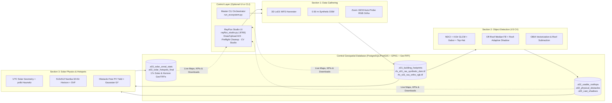

# RayFlux Solar Intelligence Ecosystem

> **End-to-End 3D Urban Rooftop Solar PV Intelligence Platform** — Unifying 3D Building Footprint & Auto-Zoom Satellite Imagery Harvesting, Multi-Modal Computer Vision Rooftop Obstacle Detection, 32-Direction Horizon Shading, Clear-Sky Solar Irradiance Physics, Getis-Ord $G_i^*$ Spatial Hotspot Analytics, and a Full-Stack Control Center UI (**RayFlux Studio**) through a **Central PostgreSQL/PostGIS Geospatial Database**.

---

## Table of Contents

1. [System Architecture](#1-system-architecture)
2. [Repository Structure](#2-repository-structure)
3. [Central Geospatial Database & Multi-Area Architecture](#3-central-geospatial-database--multi-area-architecture)
4. [Pipeline Engines & Exclusive Section Documentation](#4-pipeline-engines--exclusive-section-documentation)
5. [RayFlux Studio — Local Control Center UI](#5-rayflux-studio--local-control-center-ui)
6. [Quick Start & Execution Manual](#6-quick-start--execution-manual)
7. [Central Database Tables & Standardized Assets](#7-central-database-tables--standardized-assets)
8. [Verified End-to-End Case Study Benchmark](#8-verified-end-to-end-case-study-benchmark)
9. [Portability & Git Repository Hygiene](#9-portability--git-repository-hygiene)

---

## 1. System Architecture

The ecosystem consists of **three decoupled, standalone-capable geospatial engines** orchestrated either through **RayFlux Studio** (`FastAPI + Leaflet/Chart.js` Control Center) or the **Master CLI** (`run_ecosystem.py`), communicating exclusively through a **Central Geospatial Database** (`PostgreSQL 16 + PostGIS 3.4` + OGC `GeoPackage` + `ESRI Shapefiles` + LZW-tiled `GeoTIFF` rasters + single `.xlsx` Excel workbooks + SHA-256 provenance catalog).



---

## 2. Repository Structure

```text
.
├── config/
│   ├── aoi_resolver.py                  # Universal AOI parser (.shp/.geojson/.gpkg/BBox) + auto UTM CRS
│   ├── ecosystem_config.py              # Master config, PostGIS DSN, multi-area factory & rfx_* paths
│   ├── cv_hyperparameters.yaml          # Default Section 2 V3 multi-modal CV thresholds
│   ├── solar_parameters.yaml            # Master Section 3 solar physics, PV & Getis-Ord Gi* parameters
│   └── profiles/                        # Regional CV presets (industrial, residential, dense_residential, mixed_urban)
├── core_db/
│   ├── env_guard.py                     # Cross-platform PROJ/GDAL runtime stabilizer
│   ├── init_postgis_cluster.py          # Automated local PostgreSQL 16 + PostGIS 3.4 cluster bootstrapper
│   ├── database_manager.py              # 4-target atomic PostGIS/GPKG/SHP/Excel writer + SHA-256 catalog
│   └── verify_setup.py                  # Environment, package & PostGIS verification script
├── section1_data_gathering/             # Section 1: 3D WFS Footprints, Synthetic DSM & RGB Orthophoto
│   └── README.md                        # Exclusive Section 1 technical manual
├── section2_object_detection/           # Section 2: Multi-Modal V3 CV Obstacle Detection (No Parallax)
│   └── README.md                        # Exclusive Section 2 technical manual
├── section3_solar_engine/               # Section 3: 32-Dir Horizon, PV Yield & Getis-Ord Gi* Hotspots
│   └── README.md                        # Exclusive Section 3 technical manual
├── studio/                              # RayFlux Studio backend (FastAPI) & frontend (Leaflet + Chart.js)
│   ├── server.py                        # REST API, preflight check, selective purge, map & download endpoints
│   ├── area_registry.py                 # Multi-area workspace & schema registry manager
│   ├── cv_profile_engine.py             # Area-type & roof-trait CV YAML synthesizer
│   ├── gis_service.py                   # PostGIS vector GeoJSON & GeoTIFF live PNG overlay service
│   ├── job_runner.py                    # Asynchronous pipeline runner with live progress & log streaming
│   ├── smart_logger.py                  # Structured diagnostic logger with automated remediation hints
│   └── static/                          # SPA Control Center (index.html, app.js, styles.css)
├── data/
│   ├── case_study_aoi/                  # Default AOI boundary input folder (rfx_aoi_boundary.*)
│   └── areas/                           # Per-area AOI boundaries created via RayFlux Studio (git-ignored)
├── database/                            # Central DB store (core/, rasters/, shapefiles/, tables/, maps/, areas/)
├── instruction/                         # Master architecture flowchart & implementation manual
├── rayflux_studio.py                    # RayFlux Studio launcher (auto-opens http://127.0.0.1:8765)
├── Launch_RayFlux_Studio.bat            # One-click Windows launcher for RayFlux Studio
├── run_ecosystem.py                     # Master CLI orchestrator
├── environment.yml                      # Conda environment specification
├── requirements.txt                     # Pip package requirements
└── .env.example                         # Environment variable template (PostGIS credentials & AOI override)
```

---

## 3. Central Geospatial Database & Multi-Area Architecture

All spatial data flow is managed by `CentralDatabaseManager` (`core_db/database_manager.py`) and `EcosystemConfig` (`config/ecosystem_config.py`):

### 3.1 Dedicated Local PostGIS Cluster (`127.0.0.1:5433`)
- Automatically initialized and started by `core_db/init_postgis_cluster.py` in `database/postgis_cluster` (isolated on port `5433` so it never conflicts with existing PostgreSQL installations).
- Database: `rayflux_spatial_db` with `CREATE EXTENSION postgis;` enabled.
- Auto-recovers transparently after machine restarts whenever any engine or Studio endpoint accesses the database.

### 3.2 Multi-Area Workspace & Schema Isolation
The platform supports unlimited independent study areas simultaneously:
- **Default Workspace:** PostGIS schema `public`, file root `database/`.
- **Registered Multi-Area Workspaces (`--area-id <id>` or RayFlux Studio):** Isolated PostGIS schema `rfx_<area_id>`, isolated file root `database/areas/<area_id>/`, isolated AOI boundary `data/areas/<area_id>/rfx_aoi_<area_id>.shp`, and dedicated CV YAML profile.

### 3.3 4-Target Atomic Vector Persistence & Read Hierarchy
- **Writes (`save_vector_dataset`):** Every vector layer commits atomically to:
  1. **PostgreSQL / PostGIS** (`<schema>.<layer_name>`, GiST indexed)
  2. **Master GeoPackage** (`<db_root>/core/rfx_db_master_geodatabase.gpkg`)
  3. **Standardized ESRI Shapefile** (`<db_root>/shapefiles/.../rfx_*.shp`, deterministic $\le 10$-char fields via `SHP_COLUMN_MAP`)
  4. **Single Excel Workbook (`.xlsx`)** for primary tabular deliverables (no duplicate `.csv` files)
  5. **SHA-256 Asset Catalog & Audit Log** (`rfx_db_asset_catalog.json` & `rfx_db_transaction_audit.log`)
- **Reads (`load_vector_dataset`):** Queries **PostGIS first**, automatically falling back to **Master GeoPackage** and then **ESRI Shapefile** (transparently restoring full canonical column names via `INV_SHP_COLUMN_MAP`).
- **Standardized Naming Convention:** Every file follows `rfx_<sec>_<kind>_<descriptor>.<ext>` (`s01`/`s02`/`s03`, `vec`/`ras`/`tbl`/`img`) resolved dynamically relative to `PROJECT_ROOT`.

---

## 4. Pipeline Engines & Exclusive Section Documentation

Each section is fully self-contained and documented in its own comprehensive technical manual covering exact inputs, database read/write mechanics, table schemas, mathematical models, and benchmarks:

1. **Section 1 — Data Gathering & Preprocessing:** [`section1_data_gathering/README.md`](section1_data_gathering/README.md)
   - Universal AOI resolution with automatic UTM CRS detection; **Dual-Mode 3D Building Footprints** (keep exact user-supplied `.shp`/`.geojson`/`.gpkg` building footprints and transfer 3D heights from spatially overlapping TUM 3D LoD1 WFS buildings, OR harvest both footprints & heights directly from WFS for drawn boundaries); $0.50\text{ m}$ `float32` Building-Only Synthetic DSM; user-selectable **Zoom 18 / Zoom 19** Esri RGB satellite orthomosaic with 3-point sharpness probing and automatic Zoom 18 fallback.
2. **Section 2 — Rooftop Object Detection (V3 Multi-Modal CV, No Parallax):** [`section2_object_detection/README.md`](section2_object_detection/README.md)
   - Fuses NDCI chromaticity (with blue-roof fraction & single-blob size guards), 4-directional GLCM texture, multi-angle Gabor energy, morphological Top-Hat/Black-Hat/Gradient, off-roof median background fill, and roof-adaptive optical shadow disambiguation to output obstacle-free `s02_usable_rooftops` polygons.
3. **Section 3 — Solar Physics, PV Yield & Spatial Hotspots:** [`section3_solar_engine/README.md`](section3_solar_engine/README.md)
   - UTC solar geometry + `pvlib.clearsky.haurwitz`; low-RAM `512×512` tile-streamed Numba 32-direction bilinear horizon ray-marching (`500 m`, `1 m` step); hemispherical SVF; 12 monthly + annual irradiance rasters; exact Section 2 obstacle-free zonal PV capacity & electricity yield; and exact continuous Gaussian Getis-Ord $G_i^*$ (`star=True`, `k=10`) hotspot clustering.

---

## 5. RayFlux Studio — Local Control Center UI

**RayFlux Studio** (`rayflux_studio.py`, served locally on `http://127.0.0.1:8765`) is a 6-tab operations console built on FastAPI + Leaflet + Chart.js that manages the entire ecosystem without needing manual scripts:

- **Overview & Energy Stats:** Portfolio & per-area KPIs (Buildings, Usable Area, `MWp`, `GWh/yr`, Mean Irradiance), 12-month generation chart, Getis-Ord $G_i^*$ distribution, and click-to-locate Top Buildings table.
- **Interactive GIS Map & Area Creator:**
  - Auto-zooms to any selected area; toggles S1/S2/S3 vector layers, All Active Area Boundaries, and live color-mapped GeoTIFF raster overlays.
  - **Draw / Import Toggle (ON/OFF):** Draw new polygons/rectangles directly on satellite imagery or upload `.shp` / `.zip` / `.geojson` / `.gpkg` boundaries, select **Zoom 18 (Fast) or Zoom 19 (HD with auto-fallback)**, choose area archetypes to auto-generate calibrated CV YAML profiles, and toggle/clear the input polygon layer cleanly.
- **Pipeline Runner (0–100) with Preflight Re-Run Protection:**
  - Clean section checkboxes (`Section 1`, `Section 2`, `Section 3`), live progress bar, streaming terminal output, cancel button, and run history.
  - **Automated Preflight & Selective Cleanup Modal:** When running on an area that already has data, Studio automatically warns the user and presents checkboxes to surgically purge only the chosen section(s) (`S1`, `S2`, `S3`, or `Remove All Sections`) from PostGIS, GPKG, shapefiles, rasters, tables, and maps before launching the fresh run.
- **CV & Solar YAML Studio:** Multi-select Area Type & Roof Trait checkboxes that synthesize validated `cv_hyperparameters.yaml` profiles in `config/profiles/`.
- **Data Manager & Downloads:** Browse PostGIS tables, preview rows, inspect generated PNG maps & Section 2 diagnostic cards, overlay rasters on the map, download `.tif` / `.xlsx` / `.gpkg` / `.zip` shapefiles, or delete assets.
- **Smart Logs, Errors & Warnings:** Filterable structured diagnostic log (`logs/rfx_studio_events.jsonl`) with automatic remediation hints and one-click PostGIS Start/Status controls.

---

## 6. Quick Start & Execution Manual

### 6.1 Environment Setup
```bash
# Create virtual environment and install dependencies
python -m venv .venv
.venv/Scripts/pip install -r requirements.txt

# Copy environment template (optional — PostGIS auto-bootstraps if absent)
cp .env.example .env

# Verify all spatial, vision, Numba, and PostGIS dependencies
.venv/Scripts/python.exe core_db/verify_setup.py
```

### 6.2 Launch RayFlux Studio (Recommended)
```bash
# Start RayFlux Studio (auto-opens http://127.0.0.1:8765)
.venv/Scripts/python.exe rayflux_studio.py

# Or double-click on Windows:
Launch_RayFlux_Studio.bat
```

### 6.3 Master CLI Orchestrator (`run_ecosystem.py`)
```bash
# Check Central Geospatial Database asset catalog & PostGIS sync status
.venv/Scripts/python.exe run_ecosystem.py --status

# Run all 3 sections end-to-end
.venv/Scripts/python.exe run_ecosystem.py --all

# Run specific sections with custom AOI, Zoom 18/19, CV profile, or registered area
.venv/Scripts/python.exe run_ecosystem.py --section 1 --aoi data/case_study_aoi/rfx_aoi_boundary.shp --zoom 18
.venv/Scripts/python.exe run_ecosystem.py --section 2 --workers 8 --cv-profile industrial
.venv/Scripts/python.exe run_ecosystem.py --section 3 --reuse-rasters
.venv/Scripts/python.exe run_ecosystem.py --all --area-id my_zone --zoom 19
```

---

## 7. Central Database Tables & Standardized Assets

| PostGIS Table (`<schema>.*`) | Produced By | Consumed By | Mirror Formats |
| :--- | :---: | :---: | :--- |
| `s01_building_footprints` | Section 1 | Sections 2 & 3, Studio | GPKG + `.shp` + `rfx_s01_tbl_building_inventory.xlsx` |
| `s02_usable_rooftops` | Section 2 | Section 3, Studio | GPKG + `.shp` + `rfx_s02_tbl_usable_area_report.xlsx` |
| `s02_physical_obstacles` | Section 2 | Studio | GPKG + `.shp` |
| `s02_cast_shadows` | Section 2 | Studio | GPKG + `.shp` |
| `s03_solar_zonal_stats` | Section 3 | Studio | GPKG + `.shp` |
| `s03_solar_hotspots_final` | Section 3 | Studio | GPKG + `.shp` + `rfx_s03_tbl_solar_potential_final.xlsx` |

---

## 8. Verified End-to-End Case Study Benchmark

Executed end-to-end across a full industrial zone (`EPSG:32639`, `3,962` 3D buildings, `100%` synced to PostgreSQL/PostGIS):

| Stage | Key Verified Metrics |
| :--- | :--- |
| **Section 1 (Data Gathering)** | `3,962` 3D LoD1 buildings (`public.s01_building_footprints`) · `0.50 m` DSM (`13,486 × 8,274 px`) · `0.4847 m` RGB Ortho (`14,415 × 8,778 px`) |
| **Section 2 (Object Detection)** | `3,489,527.6 m²` gross $\rightarrow$ **`3,369,305.8 m²` (`96.6%`)** net usable (`public.s02_usable_rooftops`) · `16,410` obstacles subtracted · `10,930` cast shadows retained · `max_area_err = 0.010 m²` |
| **Section 3 (Solar & Hotspots)** | Mean rooftop irradiance **`2,193.7 kWh/m²/yr`** (SVF `0.981`, shadow `3.7%`) · **`673.86 MWp`** installed capacity · **`1,282.92 GWh/year`** PV yield (`Jul: 153.0 GWh`, `Dec: 54.6 GWh`) · **`246`** Hot Spots (`68` at 99%, `10/10` top factories) · **`301`** Cold Spots · `0` NaNs · `0.0001%` monthly-to-annual drift |

---

## 9. Portability & Git Repository Hygiene

- **Zero Hardcoded Local Paths or Case-Study Names:** Every path is computed dynamically from `PROJECT_ROOT`; credentials and optional overrides live in `.env` (git-ignored).
- **Strict Binary Exclusion (`.gitignore`):** All heavy rasters (`*.tif`, `*.tiff`, `*.ovr`, `*.tfw`), GeoPackages (`*.gpkg`), shapefiles (`*.shp`), tile caches (`database/cache/`), area workspaces (`database/areas/`, `data/areas/`), live PostGIS cluster files (`database/postgis_cluster/`), dynamic user profiles (`config/profiles/area_*.yaml`), and logs are completely excluded from version control.
