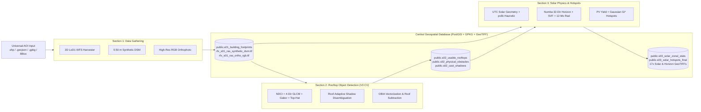

# RayFlux Solar Intelligence Ecosystem

> **End-to-End 3D Urban Rooftop Solar PV Intelligence Platform** — Unifying 3D Building Footprint & Imagery Harvesting, Multi-Modal Computer Vision Rooftop Obstacle Detection, 32-Direction Horizon Shading, Clear-Sky Solar Irradiance Physics, and Getis-Ord $G_i^*$ Spatial Hotspot Analytics through a Central PostgreSQL/PostGIS Geospatial Database.

---

## 1. System Architecture

The ecosystem consists of **three decoupled, standalone-capable engines** communicating through a single **Central Geospatial Database** (`PostgreSQL 16 + PostGIS 3.4` for vector layers, LZW-tiled `GeoTIFF` rasters, OGC `GeoPackage` + `ESRI Shapefile` mirrors, single `.xlsx` Excel reports, and SHA-256 provenance cataloging). Every file path is resolved dynamically relative to `PROJECT_ROOT` with standardized `rfx_<sec>_<kind>_<descriptor>.<ext>` naming.



---

## 2. Repository Structure

```text
.
├── config/
│   ├── aoi_resolver.py                  # Universal AOI loader (.shp/.geojson/.gpkg/BBox) + auto UTM CRS
│   ├── ecosystem_config.py              # Master configuration, PostGIS DSN & standardized rfx_* paths
│   ├── cv_hyperparameters.yaml          # Area-tunable Section 2 V3 multi-modal CV thresholds
│   └── solar_parameters.yaml            # Area-tunable Section 3 solar physics, PV & Gi* parameters
├── core_db/
│   ├── env_guard.py                     # Cross-platform PROJ/GDAL runtime stabilizer
│   ├── init_postgis_cluster.py          # Automated local PostgreSQL 16 + PostGIS 3.4 cluster bootstrapper
│   ├── database_manager.py              # Atomic PostGIS + GPKG + SHP + Excel (.xlsx) + SHA-256 manager
│   └── verify_setup.py                  # Environment & package verification script
├── section1_data_gathering/             # Section 1: 3D WFS Footprints, Synthetic DSM & RGB Orthophoto
│   └── README.md
├── section2_object_detection/           # Section 2: Multi-Modal V3 CV Obstacle Detection (No Parallax)
│   └── README.md
├── section3_solar_engine/               # Section 3: 32-Dir Horizon, PV Yield & Getis-Ord Gi* Hotspots
│   └── README.md
├── data/case_study_aoi/                 # Active AOI boundary geometry (rfx_aoi_boundary.*)
├── database/                            # Central DB store (core/, rasters/, shapefiles/, tables/, maps/)
├── instruction/                         # Master architecture flowchart & implementation manual
├── run_ecosystem.py                     # Unified master CLI orchestrator
├── environment.yml                      # Conda environment specification
├── requirements.txt                     # Pip package requirements
└── .env.example                         # Environment variable template (PostGIS credentials & AOI override)
```

---

## 3. Modules & Detailed Documentation

- **Section 1 — Data Gathering & Preprocessing:** [`section1_data_gathering/README.md`](section1_data_gathering/README.md)
  - Automated TUM 3D LoD1 WFS harvesting with session token refresh, `0.50 m` `float32` Synthetic DSM rasterization, and multi-threaded auto-zoom RGB satellite tile mosaicking.
- **Section 2 — Rooftop Object Detection (V3 Multi-Modal CV, No Parallax):** [`section2_object_detection/README.md`](section2_object_detection/README.md)
  - Fuses NDCI chromaticity (with painted-roof & component-size guards), 4-directional GLCM texture, multi-angle Gabor energy, morphological Top-Hat/Black-Hat/Gradient, off-roof median background fill, and roof-adaptive shadow disambiguation to output obstacle-free `s02_usable_rooftops` polygons.
- **Section 3 — Solar Physics, PV Yield & Spatial Hotspots:** [`section3_solar_engine/README.md`](section3_solar_engine/README.md)
  - UTC solar geometry + `pvlib.clearsky.haurwitz`, low-RAM `512×512` tile-streamed Numba 32-direction bilinear horizon ray-marching (`500 m`, `1 m` step), hemispherical SVF, 12 monthly + annual irradiance rasters, exact Section 2 obstacle-free zonal statistics, PV capacity & electricity yield, and continuous Gaussian-weighted Getis-Ord $G_i^*$ (`star=True`) hotspot clustering.

---

## 4. Quick Start

### 4.1 Environment Setup
```bash
# Create virtual environment and install dependencies
python -m venv .venv
.venv/Scripts/pip install -r requirements.txt

# Copy environment template and configure PostGIS credentials (optional — auto-bootstrapped if absent)
cp .env.example .env

# Verify all spatial, vision, and PostGIS dependencies
.venv/Scripts/python.exe core_db/verify_setup.py
```

### 4.2 Running the Ecosystem
```bash
# Check Central Geospatial Database status & PostGIS sync
.venv/Scripts/python.exe run_ecosystem.py --status

# Run the entire 3-section pipeline end-to-end
.venv/Scripts/python.exe run_ecosystem.py --all

# Run individual sections independently
.venv/Scripts/python.exe run_ecosystem.py --section 1 --aoi data/case_study_aoi/rfx_aoi_boundary.shp
.venv/Scripts/python.exe run_ecosystem.py --section 2 --workers 8
.venv/Scripts/python.exe run_ecosystem.py --section 3
.venv/Scripts/python.exe run_ecosystem.py --section 3 --reuse-rasters
```

---

## 5. Verified End-to-End Case Study Benchmark

Executed end-to-end across a full industrial zone (`EPSG:32639`, `3,962` 3D buildings, `100%` synced to PostgreSQL/PostGIS):

| Stage | Key Verified Metrics |
| :--- | :--- |
| **Section 1 (Data Gathering)** | `3,962` 3D LoD1 buildings (`public.s01_building_footprints`) · `0.50 m` DSM (`13,486 × 8,274 px`) · `0.4847 m` RGB Ortho (`14,415 × 8,778 px`) |
| **Section 2 (Object Detection)** | `3,489,527.6 m²` gross -> **`3,369,305.8 m²` (`96.6%`)** net usable (`public.s02_usable_rooftops`) · `16,410` obstacles subtracted · `10,930` cast shadows retained · `max_area_err = 0.010 m²` |
| **Section 3 (Solar & Hotspots)** | Mean rooftop irradiance **`2,193.7 kWh/m²/yr`** (SVF `0.981`, shadow `3.7%`) · **`673.86 MWp`** installed capacity · **`1,282.92 GWh/year`** PV yield (`Jul: 153.0 GWh`, `Dec: 54.6 GWh`) · **`246`** Hot Spots (`68` at 99%, `10/10` top factories) · **`301`** Cold Spots · `0` NaNs · `0.0001%` monthly-to-annual drift |

---

## 6. Central Database Tables (PostGIS `rayflux_spatial_db`)

| PostGIS Table | CRS | Records | Description |
| :--- | :---: | :---: | :--- |
| `public.s01_building_footprints` | `EPSG:32639` | `3,962` | Harvested 3D LoD1 building footprints with height & floor attributes |
| `public.s02_usable_rooftops` | `EPSG:32639` | `3,962` | Obstacle-subtracted PV-ready rooftop polygons & usable metrics |
| `public.s02_physical_obstacles` | `EPSG:32639` | `16,410` | Vectorized rooftop obstacles (`COOLER_AC`, `PENTHOUSE`, `CHIMNEY_VENT`) |
| `public.s02_cast_shadows` | `EPSG:32639` | `10,930` | Disambiguated optical cast shadows (retained as usable roof area) |
| `public.s03_solar_zonal_stats` | `EPSG:32639` | `3,962` | Annual & 12-month rooftop solar irradiance, SVF & daytime shadow stats |
| `public.s03_solar_hotspots_final` | `EPSG:32639` | `3,962` | Final PV capacity (`kWp`), annual/monthly yield (`MWh`) & Getis-Ord $G_i^*$ clusters |
