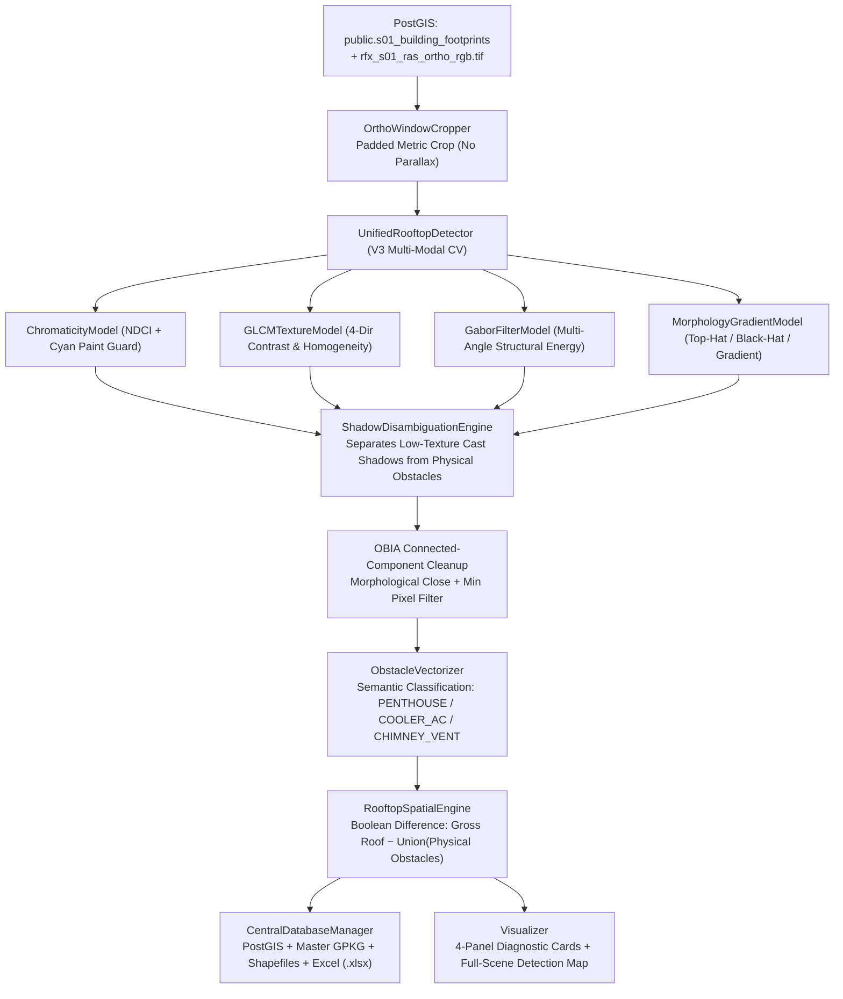

# Section 2: Multi-Modal Rooftop Object Detection Engine (`section2_object_detection/`)

> **RayFlux Solar Intelligence Ecosystem** — Deterministic Multi-Modal Computer Vision, Physics-Informed Shadow Disambiguation, OBIA Vectorization, and Topological Net Usable Rooftop Subtraction.

---

## 1. Purpose & Architectural Role

Section 2 transforms the raw 3D building footprints (`public.s01_building_footprints`) and high-resolution RGB orthophoto (`rfx_s01_ras_ortho_rgb.tif`) produced by Section 1 into **PV-ready Net Usable Rooftop polygons** (`public.s02_usable_rooftops`), **physical rooftop obstacle polygons** (`public.s02_physical_obstacles`), and **cast shadow polygons** (`public.s02_cast_shadows`).

By design, Section 2 operates **strictly without Photogrammetric Parallax or Inverse Nadir Restoration**—every roof footprint is cropped directly in the unified metric UTM coordinate reference system (`EPSG:32639`). All algorithmic thresholds, texture windows, morphological kernels, and semantic area boundaries are centralized in [`config/cv_hyperparameters.yaml`](../config/cv_hyperparameters.yaml) so the engine can be tuned for any geographic or architectural zone without modifying code.

---

## 2. End-to-End Pipeline Flow



---

## 3. Module Architecture

| File | Responsibility |
| :--- | :--- |
| `section2_object_detection/cv_config.py` | Typed dataclass schema (`CVHyperparameters`) and YAML loader wired to `config/cv_hyperparameters.yaml`. |
| `section2_object_detection/vision_models/chromaticity_ndci.py` | Normalized Difference Cyan Index (NDCI) for evaporative coolers/HVAC units, plus an industrial blue-painted roof guard (`max_cyan_roof_fraction`). |
| `section2_object_detection/vision_models/texture_glcm.py` | Vectorized 4-directional (`0°`, `45°`, `90°`, `135°`) Gray-Level Co-occurrence Matrix computing local Contrast and Homogeneity. |
| `section2_object_detection/vision_models/gabor_bank.py` | Multi-orientation Gabor filter bank (`0°`, `45°`, `90°`, `135°`) extracting directional structural edge energy. |
| `section2_object_detection/vision_models/morphology_tophat.py` | White Top-Hat (bright skylights/vents), Black Top-Hat (dark chimneys/shafts), and Morphological Gradient edge extractor. |
| `section2_object_detection/vision_models/shadow_disambiguator.py` | Physics-informed shadow filter isolating dark, low-contrast, high-homogeneity, low-Gabor-energy cast shadows so they are **retained** as usable roof area rather than subtracted. |
| `section2_object_detection/vision_models/unified_detector.py` | Master V3 fusion engine combining all 5 models + OBIA morphological closing and connected-component filtering. |
| `section2_object_detection/vectorizer_topology.py` | `OrthoWindowCropper`, `ObstacleVectorizer` (semantic area classification + topology-preserving simplification), and `RooftopSpatialEngine` (`Gross Roof − Union(Obstacles)`). |
| `section2_object_detection/visualizer.py` | Renders 4-panel per-building diagnostic cards and the full-scene RGB + obstacle/usable-roof overview map. |
| `section2_object_detection/run_section2.py` | Standalone multi-process orchestrator (`ProcessPoolExecutor`) committing all outputs atomically via `CentralDatabaseManager`. |

---

## 4. Mathematical & Algorithmic Summary

1. **Luminance & NDCI Chromaticity (`chromaticity_ndci.py`)**
   - Perceived luminance: $L = 0.299R + 0.587G + 0.114B$.
   - Cyan index: $\text{NDCI} = \frac{B - R}{B + R + \epsilon}$.
   - Pixels with $\text{NDCI} > \tau_{\text{cyan}}$ and $B > B_{\min}$ are flagged as cooler candidates, **unless** the flagged fraction across the roof exceeds `max_cyan_roof_fraction` (default `0.35`), which suppresses false positives on blue-painted corrugated metal roofs.

2. **4-Directional GLCM Texture (`texture_glcm.py`)**
   - Grayscale image is quantized to $N_L = 32$ levels; pixel pairs across 4 offsets `[(0,1), (1,0), (1,1), (1,-1)]` yield local box-averaged:
     $$\text{Contrast} = \mathbb{E}[(I_i - I_j)^2], \qquad \text{Homogeneity} = \mathbb{E}\left[\frac{1}{1 + |I_i - I_j|}\right]$$

3. **Gabor Directional Energy (`gabor_bank.py`)**
   - Maximum magnitude response across 4 orientations $\theta \in \{0, \frac{\pi}{4}, \frac{\pi}{2}, \frac{3\pi}{4}\}$ at spatial frequency $f = 0.25$.

4. **Morphological Top-Hat / Black-Hat / Gradient (`morphology_tophat.py`)**
   - Isolates localized bright and dark rooftop protrusions (`tophat > 32` or `blackhat > 32`) and high-gradient structural edges (`gradient > 24`).

5. **Physics-Informed Shadow Disambiguation (`shadow_disambiguator.py`)**
   - A pixel inside the roof mask is classified as a **Cast Shadow** if and only if:
     $$(L < L_{\text{shd}}) \land (\text{Contrast} < C_{\text{shd}}) \land (\text{Homogeneity} > H_{\text{shd}}) \land (E_{\text{Gabor}} < E_{\text{shd}})$$
   - Cast shadows are vectorized for reporting (`s02_cast_shadows`) but **explicitly excluded** from obstacle subtraction because solar irradiance shading is modeled dynamically in Section 3.

6. **Physical Obstacle Fusion & Topological Subtraction (`unified_detector.py`, `vectorizer_topology.py`)**
   - Physical obstacle mask = `(NDCI Cooler | High-Contrast Textured Body | Top-Hat/Black-Hat Anomaly | High-Gabor Structural Boundary) AND NOT Cast Shadow`.
   - Semantic classes by polygon area:
     - `PENTHOUSE`: $\ge 10.0\text{ m}^2$
     - `COOLER_AC`: $1.00\text{ m}^2 \le A < 10.0\text{ m}^2$
     - `CHIMNEY_VENT`: $0.45\text{ m}^2 \le A < 1.00\text{ m}^2$
   - Net Usable Geometry: `Gross Roof.difference(unary_union(Physical Obstacles))`, dropping sliver patches $< 2.0\text{ m}^2$.
   - Suitability Status: `EXCELLENT` ($\ge 60\%$), `GOOD` ($40\text{–}60\%$), `MODERATE` ($20\text{–}40\%$), `LIMITED` ($< 20\%$).

---

## 5. Area-Specific Tuning (`config/cv_hyperparameters.yaml`)

All thresholds are controlled via [`config/cv_hyperparameters.yaml`](../config/cv_hyperparameters.yaml). Key tunable sections:
- `cropping`: `pad_meters`
- `chromaticity`: `cyan_index_thresh`, `cyan_min_blue`, `max_cyan_roof_fraction`, `lum_object_min`, `lum_object_max`
- `glcm`: `window_size`, `levels`, `contrast_obj_thresh`, `contrast_shadow_max`, `homogeneity_shadow_min`
- `gabor`: `frequency`, `angles`, `energy_obj_thresh`
- `morphology`: `kernel_size`, `tophat_thresh`, `blackhat_thresh`, `gradient_thresh`
- `shadow`: `lum_shadow_max`, `contrast_shadow_max`, `homogeneity_shadow_min`, `gabor_energy_max`, `min_shadow_area_m2`
- `obia`: `morph_close_kernel_size`, `min_connected_pixels`, `min_physical_object_area_m2`
- `semantic`: `penthouse_min_area_m2`, `cooler_min_area_m2`
- `usable_area`: `min_usable_patch_area_m2`, `polygon_simplify_tol_m`

---

## 6. Execution

Run standalone from the repository root:

```bash
.venv/Scripts/python.exe section2_object_detection/run_section2.py
```

---

## 7. Standardized Database Outputs (`s02_vision`)

| Asset | Storage Location (Project-Relative) | Format / Table |
| :--- | :--- | :--- |
| **Net Usable Rooftops** | `database/shapefiles/s02_vision/rfx_s02_vec_usable_rooftops.shp` | PostGIS `public.s02_usable_rooftops` + GPKG + `.shp` |
| **Physical Obstacles** | `database/shapefiles/s02_vision/rfx_s02_vec_physical_obstacles.shp` | PostGIS `public.s02_physical_obstacles` + GPKG + `.shp` |
| **Cast Shadows** | `database/shapefiles/s02_vision/rfx_s02_vec_cast_shadows.shp` | PostGIS `public.s02_cast_shadows` + GPKG + `.shp` |
| **Usable Area Report** | `database/tables/s02_vision/rfx_s02_tbl_usable_area_report.xlsx` | Single tabular Excel report (`.xlsx` only) |
| **Full-Scene Detection Map** | `database/maps/s02_vision/rfx_s02_img_scene_detection_map.png` | High-res RGB + Usable Roof / Obstacle overlay |
| **Per-Building Diagnostic Cards** | `database/maps/s02_vision/cards/rfx_s02_img_roof_diag_bldg_XXXX.png` | 4-panel visual QA cards |
| **Asset Catalog & Audit Log** | `database/core/rfx_db_asset_catalog.json`, `database/core/rfx_db_transaction_audit.log` | SHA-256 provenance & transaction log |

---

## 8. Verified Case Study Benchmark

Executed end-to-end across all **3,962** buildings in `public.s01_building_footprints` (`EPSG:32639`, `0.4847 m/px` RGB orthophoto):

| Metric | Verified Result |
| :--- | :--- |
| **Runtime (8 workers)** | `118.9 s` |
| **Buildings Processed** | `3,962` |
| **Total Gross Roof Area** | `3,489,527.6 m²` (`348.95 ha`) |
| **Physical Obstacles Subtracted** | `16,410` polygons (`120,220.7 m²`) — `11,628` Cooler/AC, `2,557` Penthouse, `2,225` Chimney/Vent |
| **Cast Shadows Disambiguated (Retained)** | `10,930` polygons (`327,271.8 m²`) |
| **Total Net Usable Rooftop Area** | `3,369,305.8 m²` (`96.6%` of gross roof area) |
| **Suitability Breakdown** | `EXCELLENT`: 3,950 · `GOOD`: 10 · `MODERATE`: 2 · `LIMITED`: 0 |
| **Automated QA Self-Audit** | `max_area_err = 0.010 m²` · `low_usable (<30%) = 0` |
