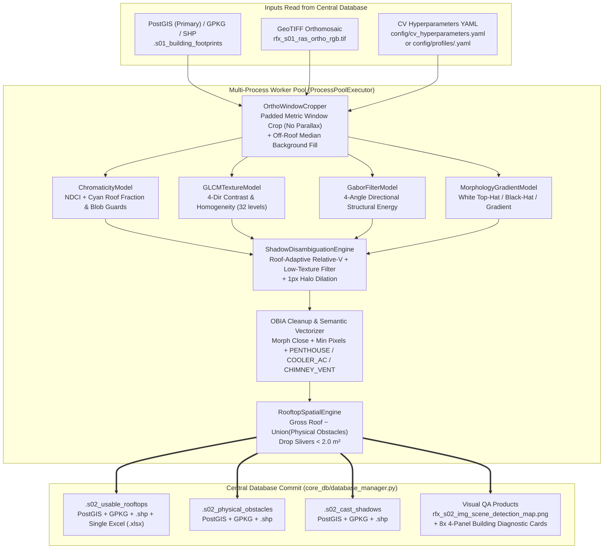

# Section 2: Multi-Modal Rooftop Object Detection Engine (`section2_object_detection/`)

> **RayFlux Solar Intelligence Ecosystem — Rooftop Computer Vision & Obstacle Subtraction (Module 2)**  
> Deterministic V3 Multi-Modal Computer Vision (NDCI + 4-Dir GLCM + Gabor + Morphological Top-Hat/Black-Hat), Off-Roof Median Background Fill, Roof-Adaptive Shadow Disambiguation, OBIA Vectorization, and Topological Net Usable Rooftop Subtraction (**Strictly No Photogrammetric Parallax**).

---

## Table of Contents

1. [Purpose & Architectural Role](#1-purpose--architectural-role)
2. [End-to-End Pipeline Flow](#2-end-to-end-pipeline-flow)
3. [Module File Inventory](#3-module-file-inventory)
4. [Inputs: How Data Is Read from the Central Database](#4-inputs-how-data-is-read-from-the-central-database)
5. [Mathematical & Algorithmic Architecture (V3 Multi-Modal CV)](#5-mathematical--algorithmic-architecture-v3-multi-modal-cv)
6. [How Outputs Are Saved in the Central Database](#6-how-outputs-are-saved-in-the-central-database)
7. [Complete Output Specifications & Database Schemas](#7-complete-output-specifications--database-schemas)
8. [How Downstream Sections & Users Read Section 2 Data](#8-how-downstream-sections--users-read-section-2-data)
9. [Hyperparameter Configuration & Regional CV Profiles (`config/profiles/`)](#9-hyperparameter-configuration--regional-cv-profiles-configprofiles)
10. [Execution Manual (Studio UI, Master CLI, Standalone & Python API)](#10-execution-manual-studio-ui-master-cli-standalone--python-api)
11. [Automated QA Self-Audit & Verified Benchmark](#11-automated-qa-self-audit--verified-benchmark)

---

## 1. Purpose & Architectural Role

Section 2 bridges **raw 3D building footprints** (Section 1) and **solar irradiance & PV yield physics** (Section 3). Instead of relying on crude flat-roof usability guesses (such as assuming 70% of every roof is clear), Section 2 inspects every single building rooftop in the high-resolution RGB orthophoto (`rfx_s01_ras_ortho_rgb.tif`) and produces:

1. **PV-Ready Net Usable Rooftops (`s02_usable_rooftops`)** — Exact boolean-subtracted clear rooftop geometries (`Gross Roof − Union(Physical Obstacles)`) with obstacle counts, shadow metrics, and 4-tier suitability grades.
2. **Vectorized Physical Obstacles (`s02_physical_obstacles`)** — Semantically classified rooftop obstructions (`PENTHOUSE`, `COOLER_AC`, `CHIMNEY_VENT`) subtracted from usable PV area.
3. **Disambiguated Optical Cast Shadows (`s02_cast_shadows`)** — Dark, low-texture optical shadows isolated and **retained as usable roof area** (so Section 3's 3D horizon ray-marcher models dynamic solar shading without double-penalizing the roof).

**Design Invariant — Zero Photogrammetric Parallax:** Section 2 operates strictly without Photogrammetric Parallax or Inverse Nadir Restoration. Every footprint is cropped directly in the unified metric UTM Coordinate Reference System (`target_crs`), with a configurable perimeter eave setback (`roof_border_erosion_px`) to guard against minor footprint-to-imagery offsets.

---

## 2. End-to-End Pipeline Flow



---

## 3. Module File Inventory

| File | Responsibility |
| :--- | :--- |
| `section2_object_detection/run_section2.py` | Standalone & orchestrated multi-process runner (`ProcessPoolExecutor`), database read/write coordinator, sample card selector, and automated area-conservation QA audit. |
| `section2_object_detection/cv_config.py` | Typed dataclass schema (`CVHyperparameters`) and YAML loader wired to `config/cv_hyperparameters.yaml` or any regional profile in `config/profiles/`. |
| `section2_object_detection/vision_models/chromaticity_ndci.py` | Normalized Difference Cyan Index (NDCI) detector with painted-metal roof fraction guard (`max_cyan_roof_fraction`) and single-blob pixel-area guard (`max_cyan_component_pixels`). |
| `section2_object_detection/vision_models/texture_glcm.py` | Vectorized 4-directional (`0°`, `45°`, `90°`, `135°`) Gray-Level Co-occurrence Matrix computing local Contrast and Homogeneity. |
| `section2_object_detection/vision_models/gabor_bank.py` | Multi-orientation Gabor filter bank (`0°`, `45°`, `90°`, `135°`) extracting directional structural edge energy. |
| `section2_object_detection/vision_models/morphology_tophat.py` | White Top-Hat (bright vents/skylights), Black Top-Hat (dark chimneys/shafts), and Morphological Gradient edge detector. |
| `section2_object_detection/vision_models/shadow_disambiguator.py` | Roof-adaptive optical cast shadow filter using luminance, HSV `max(R,G,B)`, roof-relative 75th-percentile `V` ratio, GLCM contrast/homogeneity, Gabor energy, and 1-px shadow-halo dilation. |
| `section2_object_detection/vision_models/unified_detector.py` | Master V3 fusion engine: off-roof median fill, border erosion, multi-modal fusion, shadow exclusion, morphological closing, and connected-component filtering. |
| `section2_object_detection/vectorizer_topology.py` | `OrthoWindowCropper`, `ObstacleVectorizer` (pixel-to-polygon conversion, Douglas-Peucker simplification, semantic classification), and `RooftopSpatialEngine` (boolean difference & suitability scoring). |
| `section2_object_detection/visualizer.py` | Renders 4-panel per-building diagnostic cards (`rfx_s02_img_roof_diag_bldg_XXXX.png`) and the full-scene RGB + usable/obstacle/shadow map (`rfx_s02_img_scene_detection_map.png`). |

---

## 4. Inputs: How Data Is Read from the Central Database

Section 2 reads all inputs exclusively through `CentralDatabaseManager` and `EcosystemConfig`:

### 4.1 Reading Building Footprints (`s01_building_footprints`)
```python
bldgs_gdf = db_mgr.load_vector_dataset(
    cfg.db.s01_footprints_shp,
    gpkg_layer="s01_building_footprints",
)
```
**Read Resolution Order:**
1. **Primary — PostgreSQL/PostGIS:** Executes `SELECT * FROM "<schema>"."s01_building_footprints"` on `127.0.0.1:5433/rayflux_spatial_db` (auto-starting PostGIS if needed). Logs `READ_POSTGIS` to `rfx_db_transaction_audit.log`.
2. **Fallback 1 — Master GeoPackage:** Reads layer `s01_building_footprints` from `<db_root>/core/rfx_db_master_geodatabase.gpkg`.
3. **Fallback 2 — ESRI Shapefile:** Reads `<db_root>/shapefiles/s01_base/rfx_s01_vec_building_footprints.shp` and automatically restores full column names via `INV_SHP_COLUMN_MAP`.
- Enforces `target_crs` and serializes `(building_id, geometry.wkb)` chunks for parallel worker distribution.

### 4.2 Reading the RGB Orthophoto (`rfx_s01_ras_ortho_rgb.tif`)
- Each worker opens its own read-only `rasterio` handle to `cfg.db.s01_ortho_tif` (`<db_root>/rasters/s01_base/rfx_s01_ras_ortho_rgb.tif`).
- `OrthoWindowCropper.crop_building(geom)` performs **windowed disk reads** padded by `pad_meters = 4.0 m` around each building's bounding box — keeping RAM usage minimal even for gigabyte-scale orthomosaics.

### 4.3 Reading CV Hyperparameters
- Loaded from `cfg.cv_hyperparams_yaml` (defaults to `config/cv_hyperparameters.yaml`, or overridden via `--cv-profile <name>` / RayFlux Studio area registry).

---

## 5. Mathematical & Algorithmic Architecture (V3 Multi-Modal CV)

1. **Off-Roof Median Background Fill (`mask_outside_roof_fill: true`) & Perimeter Setback (`roof_border_erosion_px: 2`):**
   - Before running sliding-window filters (GLCM, Gabor, Morphology), all pixels outside the building footprint polygon are replaced with the **median grayscale value of the roof interior**. This completely prevents bright roads, dark alleys, or adjacent trees from bleeding high-contrast edge artifacts onto the roof perimeter.
   - A 2-pixel ($\approx 1.0\text{ m}$) morphological erosion on the analysis mask absorbs minor eave/parapet overhangs.

2. **NDCI Chromaticity with Painted-Roof Guards (`chromaticity_ndci.py`):**
   - Luminance: $L = 0.299R + 0.587G + 0.114B$
   - Normalized Difference Cyan Index:
     $$\text{NDCI} = \frac{B - R}{B + R + \epsilon}$$
   - Flagged as localized cooler/HVAC candidate when $\text{NDCI} > 0.14$ and $B > 95$, subject to **two industrial roof guards**:
     - If $> 25\%$ (`max_cyan_roof_fraction`) of the roof is cyan, the roof is a blue-painted metal shed (cooler channel suppressed).
     - Any single connected cyan blob $> 40\text{ px}$ (`max_cyan_component_pixels`, $\approx 9.4\text{ m}^2$) is rejected as a painted roof panel rather than an HVAC unit.

3. **4-Directional Vectorized GLCM Texture (`texture_glcm.py`):**
   - Quantizes luminance to $N_L = 32$ levels and computes $5 \times 5$ box-averaged texture across 4 offsets `[(0,1), (1,0), (1,1), (1,-1)]`:
     $$\text{Contrast} = \mathbb{E}[(I_i - I_j)^2], \qquad \text{Homogeneity} = \mathbb{E}\left[\frac{1}{1 + |I_i - I_j|}\right]$$

4. **Multi-Orientation Gabor Filter Bank (`gabor_bank.py`):**
   - Maximum magnitude response across $\theta \in \{0, \frac{\pi}{4}, \frac{\pi}{2}, \frac{3\pi}{4}\}$ at spatial frequency $f = 0.25$ (wavelength $4\text{ px}$), capturing sharp structural chassis edges (`energy_obj_thresh = 5.5`).

5. **Morphological Top-Hat, Black-Hat & Gradient (`morphology_tophat.py`):**
   - $3 \times 3$ structuring element isolating bright specular vents (`tophat > 32`), dark chimney/flue openings (`blackhat > 32`), and steep roof-equipment edges (`gradient > 24`).

6. **Roof-Adaptive Shadow Disambiguation (`shadow_disambiguator.py`):**
   - A pixel inside the roof is classified as an optical **Cast Shadow** iff:
     $$(L < 85) \land (\max(R,G,B) < 110) \land (V < 0.68 \cdot V_{75,\text{roof}}) \land (\text{Contrast} < 20) \land (\text{Homogeneity} > 0.10) \land (E_{\text{Gabor}} < 5.0)$$
   - The roof-relative $V_{75,\text{roof}}$ guard prevents shaded sides of pitched gable roofs and dark-painted red/blue/green metal sheets from being misclassified as cast shadows.
   - A 1-pixel halo dilation (`shadow_halo_dilation_px = 1`) suppresses bright-to-dark shadow-edge gradient rings.

7. **Obstacle Fusion, Semantic Classification & Boolean Roof Subtraction (`unified_detector.py`, `vectorizer_topology.py`):**
   - `Physical Obstacle Mask = (NDCI | High-Contrast | Top/Black-Hat | High-Gabor) AND NOT Cast Shadow`, cleaned by $3\times3$ morphological closing and connected-component filtering (`>= 4 px` and `>= 0.90 m²`).
   - **Semantic Classes:** `PENTHOUSE` ($\ge 10.0\text{ m}^2$), `COOLER_AC` ($1.00 \le A < 10.0\text{ m}^2$), `CHIMNEY_VENT` ($0.90 \le A < 1.00\text{ m}^2$).
   - **Boolean Difference:** `Net Usable Geometry = Gross Roof.difference(unary_union(Physical Obstacles))`, dropping sliver patches $< 2.00\text{ m}^2$.
   - **Suitability Grades:** `EXCELLENT` ($\ge 60\%$), `GOOD` ($40\text{–}60\%$), `MODERATE` ($20\text{–}40\%$), `LIMITED` ($< 20\%$).

---

## 6. How Outputs Are Saved in the Central Database

Section 2 commits **three vector layers** via `CentralDatabaseManager.save_vector_dataset()`:

```python
# 1. Net Usable Rooftops -> PostGIS + Master GPKG + Shapefile + Single Excel (.xlsx)
db_mgr.save_vector_dataset(
    gdf=usable_gdf,
    shp_path=cfg.db.s02_usable_rooftops_shp,
    gpkg_layer="s02_usable_rooftops",
    excel_path=cfg.db.s02_usable_report_xlsx,
)

# 2. Physical Obstacles -> PostGIS + Master GPKG + Shapefile (if non-empty)
db_mgr.save_vector_dataset(
    gdf=obstacles_gdf,
    shp_path=cfg.db.s02_obstacles_shp,
    gpkg_layer="s02_physical_obstacles",
    excel_path=None,
)

# 3. Cast Shadows -> PostGIS + Master GPKG + Shapefile (if non-empty)
db_mgr.save_vector_dataset(
    gdf=shadows_gdf,
    shp_path=cfg.db.s02_shadows_shp,
    gpkg_layer="s02_cast_shadows",
    excel_path=None,
)
```
Every commit automatically:
- Replaces `<schema>.s02_*` in PostgreSQL/PostGIS (`127.0.0.1:5433/rayflux_spatial_db`) with GiST spatial indexing.
- Updates layers in `<db_root>/core/rfx_db_master_geodatabase.gpkg`.
- Exports UTF-8 ESRI Shapefiles with deterministic $\le 10$-char field names (`SHP_COLUMN_MAP`).
- Writes a single tabular Excel report (`rfx_s02_tbl_usable_area_report.xlsx`) with no duplicate `.csv`.
- Updates SHA-256 checksums, bounds, and counts in `rfx_db_asset_catalog.json` and logs transactions to `rfx_db_transaction_audit.log`.

---

## 7. Complete Output Specifications & Database Schemas

### 7.1 `<schema>.s02_usable_rooftops` (Primary Output Consumed by Section 3)

| PostGIS / GPKG / Excel Column | Shapefile Field ($\le 10$ chars) | Data Type | Units | Description |
| :--- | :--- | :--- | :--- | :--- |
| `building_id` | `bldg_id` | `int64` | — | Foreign/Primary key linking 1-to-1 with `s01_building_footprints`. |
| `gross_area_m2` | `gross_area` | `float64` | $\text{m}^2$ | Original gross roof footprint area. |
| `obstacle_area_m2` | `obj_area` | `float64` | $\text{m}^2$ | Total physical obstacle area subtracted from the roof. |
| `cast_shadow_area_m2` | `shd_area` | `float64` | $\text{m}^2$ | Optical cast shadow area detected (retained as usable). |
| `usable_area_m2` | `usable_are` | `float64` | $\text{m}^2$ | **Net obstacle-free PV-ready rooftop area** (`gross - obstacle`). |
| `usable_area_pct` | `usable_pct` | `float64` | `%` | Percentage of gross roof usable for PV (`usable / gross * 100`). |
| `obstacle_count` | `obj_cnt` | `int64` | count | Total physical obstacle polygons detected on the roof. |
| `cooler_ac_count` | `cooler_cnt` | `int64` | count | Count of `COOLER_AC` units ($1.0\text{–}10.0\text{ m}^2$). |
| `penthouse_count` | `penth_cnt` | `int64` | count | Count of `PENTHOUSE` / bulkhead structures ($\ge 10.0\text{ m}^2$). |
| `chimney_vent_count` | `vent_cnt` | `int64` | count | Count of `CHIMNEY_VENT` protrusions ($< 1.0\text{ m}^2$). |
| `suitability_status` | `roof_stat` | `str` | — | `EXCELLENT`, `GOOD`, `MODERATE`, or `LIMITED`. |
| `geometry` | `geometry` | `Polygon` / `MultiPolygon` | $\text{m}$ | Exact obstacle-subtracted net usable roof polygon (`target_crs`). |

### 7.2 `<schema>.s02_physical_obstacles` & `<schema>.s02_cast_shadows`

| Table | Columns (PostGIS / GPKG / Shapefile) | Description |
| :--- | :--- | :--- |
| `s02_physical_obstacles` | `building_id` (`bldg_id`), `obj_class` (`PENTHOUSE`/`COOLER_AC`/`CHIMNEY_VENT`), `area_m2`, `conf`, `geometry` | Individual physical obstacle polygons subtracted from gross roofs. |
| `s02_cast_shadows` | `building_id` (`bldg_id`), `obj_class` (`CAST_SHADOW`), `area_m2`, `geometry` | Optical cast shadow polygons preserved for QA/QC reporting. |

### 7.3 Standardized File Assets (Relative to `<db_root>`)

| Asset | Standardized Path | Format |
| :--- | :--- | :--- |
| **Net Usable Rooftops** | `shapefiles/s02_vision/rfx_s02_vec_usable_rooftops.shp` | PostGIS + GPKG + `.shp` |
| **Physical Obstacles** | `shapefiles/s02_vision/rfx_s02_vec_physical_obstacles.shp` | PostGIS + GPKG + `.shp` |
| **Cast Shadows** | `shapefiles/s02_vision/rfx_s02_vec_cast_shadows.shp` | PostGIS + GPKG + `.shp` |
| **Usable Area Report** | `tables/s02_vision/rfx_s02_tbl_usable_area_report.xlsx` | Single Excel workbook (`.xlsx`) |
| **Full-Scene Detection Map** | `maps/s02_vision/rfx_s02_img_scene_detection_map.png` | High-res RGB + Usable / Obstacle / Shadow overlay |
| **4-Panel Diagnostic Cards** | `maps/s02_vision/cards/rfx_s02_img_roof_diag_bldg_XXXX.png` | Up to 8 representative 4-panel building QA cards |

---

## 8. How Downstream Sections & Users Read Section 2 Data

Section 3 automatically loads `s02_usable_rooftops` via `CentralDatabaseManager.load_vector_dataset()`:
```python
usable_gdf = db_mgr.load_vector_dataset(
    cfg.db.s02_usable_rooftops_shp,
    gpkg_layer="s02_usable_rooftops",
)
```
Section 3 performs an exact `building_id` join against `s01_building_footprints` and computes zonal irradiance statistics and PV yields **strictly over the obstacle-free polygons** (`usable_gdf.geometry` and `usable_area_m2`).

---

## 9. Hyperparameter Configuration & Regional CV Profiles (`config/profiles/`)

All thresholds live in [`config/cv_hyperparameters.yaml`](../config/cv_hyperparameters.yaml). In addition, **RayFlux Studio's CV & Solar YAML Studio** (backed by `studio/cv_profile_engine.py`) can synthesize and save calibrated area-specific YAML profiles under `config/profiles/`:
- **Built-in Archetype Presets:** `industrial.yaml`, `residential.yaml`, `dense_residential.yaml`, `mixed_urban.yaml`.
- **Dynamic Area Profiles:** Selecting area types (`industrial`, `residential`, `dense_residential`, `commercial`, `mixed_urban`, `rural`) and roof traits (`painted_metal_roofs`, `pitched_gables`, `dense_hvac_coolers`, `heavy_shadowing`) automatically tunes `max_cyan_roof_fraction`, `relative_v_ratio`, `contrast_obj_thresh`, `min_connected_pixels`, and `roof_border_erosion_px`.

---

## 10. Execution Manual (Studio UI, Master CLI, Standalone & Python API)

```bash
# 1. Recommended: Run via RayFlux Studio (with automatic preflight check & CV profile selector)
.venv/Scripts/python.exe rayflux_studio.py

# 2. Master CLI Orchestrator
.venv/Scripts/python.exe run_ecosystem.py --section 2 --workers 8
.venv/Scripts/python.exe run_ecosystem.py --section 2 --area-id my_zone --cv-profile industrial

# 3. Standalone Section 2 Execution
.venv/Scripts/python.exe section2_object_detection/run_section2.py
```

**Python API:**
```python
from config.ecosystem_config import EcosystemConfig
from section2_object_detection.run_section2 import run_section2

summary = run_section2(config=EcosystemConfig(), max_workers=8, num_diagnostic_cards=8)
print(summary["total_usable_m2"], summary["usable_pct"])
```

---

## 11. Automated QA Self-Audit & Verified Benchmark

At completion, `run_section2.py` automatically audits **area conservation** across every building:
$$\max_i \left| (\text{usable\_area\_m2}_i + \text{obstacle\_area\_m2}_i) - \text{gross\_area\_m2}_i \right|$$
and flags any anomalous buildings with `< 30%` usable area.

### Verified Case Study Benchmark (`3,962` Buildings, `EPSG:32639`, `0.4847 m/px` RGB Ortho)
| Metric | Verified Result |
| :--- | :--- |
| **Runtime (8 CPU Workers)** | `118.9 s` |
| **Buildings Processed** | `3,962` (`100%` PostGIS synced) |
| **Total Gross Roof Area** | `3,489,527.6 m²` (`348.95 ha`) |
| **Physical Obstacles Subtracted** | `16,410` polygons (`120,220.7 m²`) — `11,628` `COOLER_AC`, `2,557` `PENTHOUSE`, `2,225` `CHIMNEY_VENT` |
| **Cast Shadows Disambiguated (Retained)** | `10,930` polygons (`327,271.8 m²`) |
| **Total Net Usable Rooftop Area** | **`3,369,305.8 m²` (`96.6%` of gross roof area)** |
| **Suitability Breakdown** | `EXCELLENT`: 3,950 · `GOOD`: 10 · `MODERATE`: 2 · `LIMITED`: 0 |
| **Automated QA Self-Audit** | `max_area_err = 0.010 m²` · `low_usable (<30%) = 0` |
