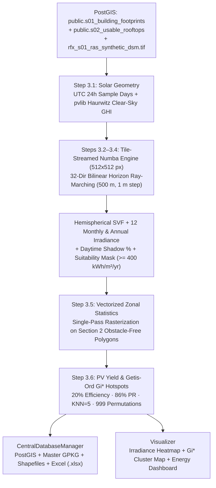

# Section 3: Solar Physics, 32-Direction Horizon Shading, PV Yield & Spatial Hotspots (`section3_solar_engine/`)

> **RayFlux Solar Intelligence Ecosystem** — Clear-Sky Solar Geometry, Numba-Accelerated 32-Direction Bilinear Horizon Ray-Marching, Hemispherical Sky View Factor (SVF), Monthly & Annual PV Generation Modeling over Obstacle-Free Rooftops, and Getis-Ord Gi* Spatial Hotspot Clustering.

---

## 1. Purpose & Architectural Role

Section 3 is the core physical and geospatial analytics engine of the RayFlux Ecosystem. It consumes:
- **`rfx_s01_ras_synthetic_dsm.tif`** (`0.50 m` 3D building DSM from Section 1)
- **`public.s01_building_footprints`** (3D building heights & floor counts from Section 1)
- **`public.s02_usable_rooftops`** (obstacle-free net usable rooftop polygons & `usable_area_m2` from Section 2 — replacing the legacy fixed 70% flat-roof guess; gracefully falls back to `fallback_usable_ratio: 0.70` only if Section 2 has not been executed)

and computes pixel-level 3D shading, monthly and annual solar irradiance (`kWh/m²`), per-building installed PV capacity (`kWp`), monthly and annual electricity yield (`MWh`), and statistically significant **Getis-Ord Gi*** spatial energy clusters — committing all results atomically to PostgreSQL/PostGIS, the Master GeoPackage, standardized ESRI Shapefiles, and a single final Excel workbook (`.xlsx`).

All physical, horizon, PV, and spatial-clustering parameters are externalized in [`config/solar_parameters.yaml`](../config/solar_parameters.yaml).

---

## 2. End-to-End Pipeline Flow



---

## 3. Module Architecture

| File | Responsibility |
| :--- | :--- |
| `config/solar_parameters.yaml` | Externalized master config controlling solar calendar, clear-sky model, horizon ray-marching, suitability threshold, PV specs, and Gi* clustering. |
| `section3_solar_engine/solar_config.py` | Typed dataclass schema (`SolarParameters`) and YAML loader. |
| `section3_solar_engine/solar_geometry.py` | Step 3.1: Extracts AOI center `(lat, lon)` from DSM, preserves physical site elevation, generates complete UTC 24h sample days, and computes `pvlib.solarposition` + `pvlib.clearsky.haurwitz(apparent_zenith)`. |
| `section3_solar_engine/horizon_radiation_engine.py` | Steps 3.2–3.4: Memory-safe `512×512` tile-streamed `@njit(parallel=True)` 32-direction bilinear horizon ray-marcher, hemispherical SVF, 12 monthly + annual irradiance rasters, daytime shadow %, and radiation suitability mask. |
| `section3_solar_engine/zonal_energy_hotspots.py` | Steps 3.5–3.6: Joins Section 2 `s02_usable_rooftops` with Section 1 3D attributes, extracts exact vectorized zonal stats across 15 rasters, computes annual/monthly PV capacity & yield, and executes Getis-Ord Gi* hotspot analysis. |
| `section3_solar_engine/visualizer.py` | Renders the annual irradiance heatmap, 7-tier Getis-Ord Gi* cluster map, and 2-panel PV energy distribution & monthly generation dashboard. |
| `section3_solar_engine/run_section3.py` | Standalone end-to-end orchestrator with PostGIS persistence, SHA-256 raster registration, and automated QA self-audit. |

---

## 4. Scientific & Computational Upgrades Over Legacy Baseline

1. **Exact UTC Complete-Day Alignment (Fixes 2× Monthly Underestimation):** Generating sample days directly in UTC ensures every sampled day spans a complete 24-hour window inside a single `day_of_year` and never splits across UTC midnight, eliminating double-counted sample days during monthly scaling.
2. **True `pvlib.clearsky.haurwitz(apparent_zenith)`:** Uses `pvlib.clearsky.haurwitz` on `apparent_zenith` (with configurable `atmospheric_clearness_kt`) instead of silently falling back to a fixed atmospheric constant.
3. **Hemispherical Sky View Factor (SVF) Clamping:** Negative horizon elevation angles (rooftops elevated above surrounding ground) are clamped to `0°` before computing $\text{SVF} = \frac{1}{N}\sum_{d=1}^{N}\cos^2(\max(0, \theta_d))$, ensuring elevated unobstructed roofs achieve $\text{SVF} = 1.0$.
4. **True Daytime Shadow Percentage:** Divides shaded steps strictly by daytime solar timesteps ($\alpha_{\text{sun}} > 0^\circ$) rather than 24-hour total timesteps.
5. **Bit-for-Bit Exact Ray-Marching Acceleration & Low-RAM Streaming:**
   - Tracks monotonic slope $(z - z_0) / d$ in the inner loop and invokes `atan()` once per ray (instead of 500 `atan2()` calls).
   - Uses an exact mathematical upper-bound early exit: $(z_{\max} - z_0) / d \le s_{\max}$.
   - Streams `512×512` tiles (< 1 GB peak RAM vs. 14.3 GB full-grid allocation) over active rooftop pixels while ray-marching against the full `8,274 × 13,486` 3D DSM.
6. **Section 2 Obstacle-Free Integration:** Computes zonal statistics and PV yields directly on obstacle-subtracted `public.s02_usable_rooftops` polygons rather than a flat 70% heuristic.

---

## 5. Core Physical & Statistical Equations

- **Direct & Diffuse Irradiance per Timestep ($\Delta t = 0.5\text{ h}$):**
  $$E_{\text{step}} = \left[\mathbb{I}(\alpha_{\text{sun}} \ge \theta_{h,d}) \cdot (1 - f_{\text{diff}}) + f_{\text{diff}} \cdot \text{SVF}\right] \cdot \text{GHI}_{\text{clear}} \cdot \Delta t$$
- **Monthly & Annual Irradiance ($\text{kWh/m}^2$):**
  $$H_m = \frac{D_m}{N_{\text{sample},m}} \cdot 10^{-3} \sum_{k \in m} E_{\text{step},k}, \qquad H_{\text{annual}} = \sum_{m=1}^{12} H_m$$
- **Installed PV Capacity ($\text{kWp}$) & Annual Electricity Yield ($\text{MWh/yr}$):**
  $$P_{\text{cap}} = A_{\text{usable}} \cdot \eta_{\text{PV}}, \qquad E_{\text{PV}} = \eta_{\text{PV}} \cdot \text{PR} \cdot \frac{H_{\text{mean}} \cdot A_{\text{usable}}}{1000}$$
  with defaults $\eta_{\text{PV}} = 0.20$ and $\text{PR} = 0.86$.
- **Getis-Ord $G_i^*$ Spatial Clustering (Ord & Getis 1995):** Computed on $x_i = \sqrt{E_{\text{PV},i}}$ with adaptive continuous Gaussian kernel weights (`k=10`, `star=True`, self-weight $w_{ii}=1.0$) and exact two-tailed analytical $Z$-test ($p = 2(1 - \Phi(|Z|))$), classified into 7 confidence tiers (`99%`, `95%`, `90%` Hot/Cold Spots and `Not Significant`). This fixes the legacy `star=False` bug (which excluded the building itself and mislabeled isolated mega-factories as Cold Spots).

---

## 6. Execution

Run standalone from the repository root:

```bash
.venv/Scripts/python.exe section3_solar_engine/run_section3.py
```

---

## 7. Standardized Database Outputs (`s03_solar`)

| Asset | Project-Relative Path | Format / Table |
| :--- | :--- | :--- |
| **Solar Geometry Lookup** | `database/tables/s03_solar/rfx_s03_tbl_solar_geometry.csv` | UTC Solar Zenith, Azimuth & Haurwitz GHI |
| **32-Dir Horizon Angles** | `database/rasters/s03_solar/rfx_s03_ras_horizon_angles_32dir.tif` | 32-band `float32` BigTIFF (`0.50 m`) |
| **Sky View Factor (SVF)** | `database/rasters/s03_solar/rfx_s03_ras_sky_view_factor.tif` | `float32` GeoTIFF (`0.0–1.0`) |
| **Annual Irradiance** | `database/rasters/s03_solar/rfx_s03_ras_irradiance_annual.tif` | `float32` GeoTIFF (`kWh/m²/yr`) |
| **Monthly Irradiance (12×)** | `database/rasters/s03_solar/monthly/rfx_s03_ras_irradiance_m01..m12.tif` | 12× `float32` GeoTIFFs (`kWh/m²/month`) |
| **Daytime Shadow Fraction** | `database/rasters/s03_solar/rfx_s03_ras_shadow_fraction_annual.tif` | `float32` GeoTIFF (`0–100%`) |
| **Radiation Suitability Mask** | `database/rasters/s03_solar/rfx_s03_ras_suitability_mask.tif` | Binary `float32` GeoTIFF (`>= 400 kWh/m²/yr`) |
| **Solar Zonal Statistics** | `database/shapefiles/s03_solar/rfx_s03_vec_solar_zonal_stats.shp` | PostGIS `public.s03_solar_zonal_stats` + GPKG + `.shp` |
| **Final PV Energy & Hotspots** | `database/shapefiles/s03_solar/rfx_s03_vec_solar_hotspots_final.shp` | PostGIS `public.s03_solar_hotspots_final` + GPKG + `.shp` |
| **Final Solar Potential Table** | `database/tables/s03_solar/rfx_s03_tbl_solar_potential_final.xlsx` | Single Excel workbook (`.xlsx` only) |
| **Irradiance Heatmap** | `database/maps/s03_solar/rfx_s03_img_irradiance_heatmap.png` | High-res RGB + Irradiance overlay |
| **Gi* Hotspot Cluster Map** | `database/maps/s03_solar/rfx_s03_img_hotspots_cluster_map.png` | 7-tier Getis-Ord Gi* spatial cluster map |
| **PV Energy Dashboard** | `database/maps/s03_solar/rfx_s03_img_energy_distribution.png` | Annual distribution + Jan–Dec GWh profile |

---

## 8. Verified Case Study Benchmark

Executed end-to-end across all **3,962** obstacle-free rooftops (`EPSG:32639`, `8,274 × 13,486` DSM at `0.50 m`):

| Metric | Verified Result |
| :--- | :--- |
| **Usable Rooftop Source** | `SECTION2_CV` (`public.s02_usable_rooftops`) |
| **Buildings Analyzed** | `3,962` (`14,418,840` active rooftop pixels) |
| **Net Usable Rooftop Area** | `3,369,305.8 m²` (`336.93 ha`) |
| **Theoretical Unshaded Clear-Sky GHI** | `2,218.1 kWh/m²/yr` |
| **Mean Rooftop Annual Irradiance** | `2,193.7 kWh/m²/yr` (Mean SVF `0.981` · Mean Daytime Shadow `3.7%`) |
| **Suitable Rooftop Pixels (`>= 400 kWh/m²/yr`)** | `14,334,067` (`99.41%`) |
| **Total Installed PV Capacity (`20% STC`)** | **`673.86 MWp`** |
| **Total Annual PV Electricity Yield (`PR=86%`)** | **`1,282.92 GWh/year`** (`1,282,918.7 MWh/yr`) |
| **Per-Building Yield (Mean / Median)** | `323.8 MWh/yr` / `108.5 MWh/yr` |
| **Peak / Trough Monthly Generation** | `Jul: 153.0 GWh` · `Jun: 151.4 GWh` · `Dec: 54.6 GWh` |
| **Getis-Ord Gi* Clusters (`Gaussian k=10, star=True`)** | `246` Hot Spots (`68` 99%, `96` 95%, `82` 90%; top 10/10 largest factories = 99% Hot Spot, median `6,000 m²`) · `301` Cold Spots (`214` 95%, `87` 90%; small sheds median `81 m²`) · `3,415` Not Significant |
| **Automated QA Self-Audit** | `NaNs = 0` · `Monthly-vs-Annual Sum Drift = 0.0001%` |
