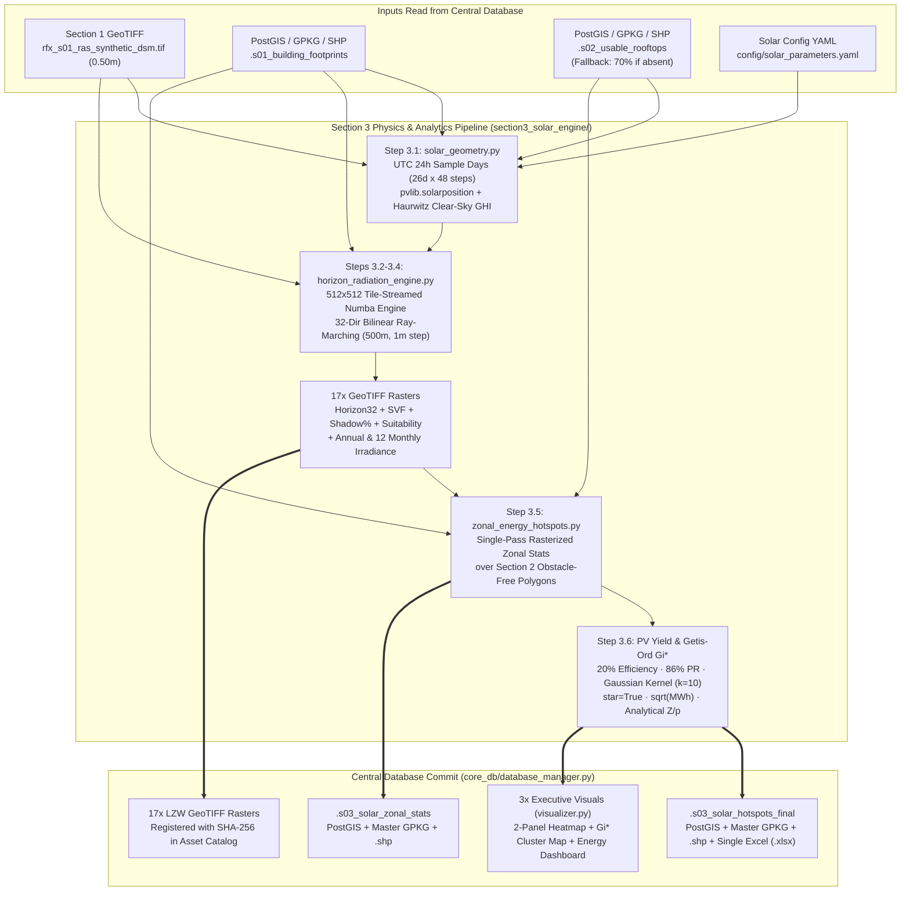

# Section 3: Solar Physics, 32-Direction Horizon Shading, PV Yield & Spatial Hotspots (`section3_solar_engine/`)

> **RayFlux Solar Intelligence Ecosystem — Solar Irradiance Physics, PV Electricity Modeling & Spatial Intelligence (Module 3)**  
> UTC Clear-Sky Solar Geometry (`pvlib.clearsky.haurwitz`), Low-RAM `512×512` Tile-Streamed Numba 32-Direction Bilinear Horizon Ray-Marching, Hemispherical Sky View Factor (SVF), Monthly & Annual Irradiance Integration, Obstacle-Free Zonal PV Yield Modeling, and Exact Continuous Gaussian Getis-Ord $G_i^*$ (`star=True`) Spatial Hotspot Clustering.

---

## Table of Contents

1. [Purpose & Architectural Role](#1-purpose--architectural-role)
2. [End-to-End Pipeline Flow](#2-end-to-end-pipeline-flow)
3. [Module File Inventory](#3-module-file-inventory)
4. [Inputs: How Data Is Read from the Central Database](#4-inputs-how-data-is-read-from-the-central-database)
5. [Physical Models, Numba Ray-Marching & Statistical Equations](#5-physical-models-numba-ray-marching--statistical-equations)
6. [How Outputs Are Saved in the Central Database](#6-how-outputs-are-saved-in-the-central-database)
7. [Complete Output Specifications & Database Schemas](#7-complete-output-specifications--database-schemas)
8. [How RayFlux Studio & External Clients Read Section 3 Data](#8-how-rayflux-studio--external-clients-read-section-3-data)
9. [Configuration Parameters Reference (`config/solar_parameters.yaml`)](#9-configuration-parameters-reference-configsolar_parametersyaml)
10. [Execution Manual (Studio UI, Master CLI, Standalone & Fast Raster Reuse)](#10-execution-manual-studio-ui-master-cli-standalone--fast-raster-reuse)
11. [Automated QA Self-Audit & Verified Benchmark](#11-automated-qa-self-audit--verified-benchmark)

---

## 1. Purpose & Architectural Role

Section 3 is the **physical solar simulation and energy analytics engine** of the RayFlux Ecosystem. It consumes the 3D Synthetic DSM and building heights from **Section 1** together with the obstacle-free net usable rooftop geometries from **Section 2** (gracefully falling back to `fallback_usable_ratio = 0.70` only if Section 2 has not been executed) and computes:

1. **Pixel-Level 3D Shadowing & Solar Irradiance Rasters (17 GeoTIFFs):** 32-direction horizon angles, hemispherical Sky View Factor (`SVF`), daytime shadow percentage, 12 monthly irradiance rasters (`m01..m12`), annual irradiance (`kWh/m²/yr`), and a radiation suitability mask (`>= 400 kWh/m²/yr`).
2. **Per-Building Zonal Statistics (`s03_solar_zonal_stats`):** Exact vectorized zonal aggregation across all 15 irradiance/SVF/shadow rasters strictly inside Section 2's obstacle-free rooftop polygons.
3. **PV Capacity, Electricity Generation & Getis-Ord $G_i^*$ Hotspots (`s03_solar_hotspots_final`):** Installed capacity (`kWp`), annual & 12-month electricity generation (`MWh`), and 7-tier statistically significant **Getis-Ord $G_i^*$** spatial energy clusters.
4. **Executive Analytical Maps & Final Excel Report:** A 2-panel PV Yield + Irradiance Heatmap, a 7-tier $G_i^*$ Cluster Map, a Monthly/Annual PV Energy Dashboard, and a single final `.xlsx` workbook.

---

## 2. End-to-End Pipeline Flow



---

## 3. Module File Inventory

| File | Responsibility |
| :--- | :--- |
| `section3_solar_engine/run_section3.py` | Master orchestrator: loads S1/S2 inputs from Central DB, runs Steps 3.1–3.6, commits vectors to PostGIS/GPKG/SHP/Excel, registers rasters in SHA-256 catalog, renders 3 visual maps, and runs the automated QA audit. |
| `section3_solar_engine/solar_config.py` | Typed dataclass schema (`SolarParameters`) and YAML loader wired to `config/solar_parameters.yaml`. |
| `section3_solar_engine/solar_geometry.py` | Step 3.1: Extracts AOI center `(lat, lon)` from the DSM, builds complete 24-hour UTC sample days, and computes `pvlib.solarposition.get_solarposition()` + `pvlib.clearsky.haurwitz(apparent_zenith)`. |
| `section3_solar_engine/horizon_radiation_engine.py` | Steps 3.2–3.4: Memory-safe `512×512` tile-streamed `@njit(parallel=True)` 32-direction bilinear horizon ray-marcher, hemispherical SVF, daytime shadow %, 12 monthly + annual irradiance rasters, and radiation suitability mask. |
| `section3_solar_engine/zonal_energy_hotspots.py` | Steps 3.5–3.6: Joins `s02_usable_rooftops` with `s01_building_footprints`, runs vectorized single-pass zonal extraction across 15 rasters (with `all_touched=True` fallback for ultra-narrow polygons), computes annual/monthly PV capacity & yield, and executes exact Ord & Getis (1995) Gaussian $G_i^*$. |
| `section3_solar_engine/visualizer.py` | Renders the 2-panel PV Yield + Pixel Irradiance Heatmap (`rfx_s03_img_irradiance_heatmap.png`), 7-tier Getis-Ord $G_i^*$ Cluster Map (`rfx_s03_img_hotspots_cluster_map.png`), and 2-panel PV Energy Dashboard (`rfx_s03_img_energy_distribution.png`). |

---

## 4. Inputs: How Data Is Read from the Central Database

Section 3 reads **all** upstream spatial assets via `CentralDatabaseManager` and `EcosystemConfig.db`:

### 4.1 Reading Section 1 & Section 2 Vector Layers (PostGIS Primary)
```python
# 1. Section 1 3D Building Footprints (heights, floors, gross area)
footprints_gdf = db_mgr.load_vector_dataset(
    cfg.db.s01_footprints_shp,
    gpkg_layer="s01_building_footprints",
)

# 2. Section 2 Obstacle-Free Usable Rooftops (primary PV geometry)
usable_gdf = db_mgr.load_vector_dataset(
    cfg.db.s02_usable_rooftops_shp,
    gpkg_layer="s02_usable_rooftops",
)
```
**Read Resolution Hierarchy:**
1. Queries PostgreSQL/PostGIS (`SELECT * FROM "<schema>"."<layer>"` on `127.0.0.1:5433/rayflux_spatial_db`).
2. Falls back to `<db_root>/core/rfx_db_master_geodatabase.gpkg`.
3. Falls back to `<db_root>/shapefiles/.../*.shp` (automatically expanding $\le 10$-char Shapefile columns back to canonical names via `INV_SHP_COLUMN_MAP`).
- **Graceful Section 2 Fallback:** If `s02_usable_rooftops` is absent or `use_section2_usable_polygons: false`, Section 3 automatically uses `s01_building_footprints` with `usable_area_m2 = gross_area_m2 * 0.70` and records `usable_source = "FALLBACK_70PCT"` (instead of `"SECTION2_CV"`).

### 4.2 Reading Section 1 Rasters
- **Required — Synthetic DSM:** `cfg.db.s01_synthetic_dsm_tif` (`<db_root>/rasters/s01_base/rfx_s01_ras_synthetic_dsm.tif`). Used for AOI centroid latitude/longitude extraction, full-scene 3D ray-marching, and pixel grid alignment.
- **Optional — RGB Orthophoto:** `cfg.db.s01_ortho_tif` (`<db_root>/rasters/s01_base/rfx_s01_ras_ortho_rgb.tif`). Used strictly as a visual basemap backdrop in `visualizer.py` when present.

---

## 5. Physical Models, Numba Ray-Marching & Statistical Equations

### 5.1 UTC Solar Geometry & Clear-Sky Irradiance (`solar_geometry.py`)
- Sample days (`day_interval = 14` $\rightarrow$ 26 complete days/yr) are generated strictly in **UTC** at `30 min` steps (`48 steps/day`) so no day splits across UTC midnight (preventing double-counted days during monthly scaling).
- Solar position is computed via `pvlib.solarposition.get_solarposition()` using physical site elevation (`altitude_m = 1200.0 m`).
- Clear-sky Global Horizontal Irradiance ($\text{GHI}_{\text{clear}}$) is computed via `pvlib.clearsky.haurwitz(apparent_zenith)` scaled by `atmospheric_clearness_kt` (default `1.00`).

### 5.2 Bit-for-Bit Exact 32-Direction Horizon Ray-Marching & SVF (`horizon_radiation_engine.py`)
- Streams `512 × 512` pixel tiles (`< 1 GB` peak RAM even on `13,486 × 8,274` DSMs) over active rooftop pixels while bilinearly ray-marching against the **entire 3D DSM** across $N = 32$ azimuths ($11.25^\circ$ spacing), up to $500\text{ m}$ at $1.0\text{ m}$ steps.
- **Exact Slope Acceleration:** Tracks monotonic maximum slope $s_{\max} = \max_d \frac{z(d) - z_0}{d}$ in the inner loop (calling `atan()` once per ray) with an exact mathematical early-exit bound: $(z_{\max} - z_0) / d \le s_{\max}$.
- **Hemispherical Sky View Factor (SVF):** Clamps negative horizon angles (elevated rooftops looking down at lower ground) to $0^\circ$:
  $$\text{SVF} = \frac{1}{N} \sum_{d=1}^{N} \cos^2\!\big(\max(0, \theta_{h,d})\big)$$
- **Timestep & Monthly/Annual Irradiance ($\text{kWh/m}^2$):**
  $$E_{\text{step}} = \Big[\mathbb{I}(\alpha_{\text{sun}} \ge \theta_{h,d}) \cdot (1 - f_{\text{diff}}) + f_{\text{diff}} \cdot \text{SVF}\Big] \cdot \text{GHI}_{\text{clear}} \cdot \Delta t$$
  $$H_m = \frac{D_m}{N_{\text{sample},m}} \cdot 10^{-3} \sum_{k \in m} E_{\text{step},k}, \qquad H_{\text{annual}} = \sum_{m=1}^{12} H_m$$
- **Daytime Shadow Fraction:** Divides shaded steps strictly by daytime solar steps ($\alpha_{\text{sun}} > 0^\circ$).

### 5.3 PV Capacity & Electricity Generation (`zonal_energy_hotspots.py`)
$$P_{\text{cap}}\,[\text{kWp}] = A_{\text{usable}} \cdot \eta_{\text{PV}}, \qquad E_{\text{PV}}\,[\text{MWh/yr}] = \eta_{\text{PV}} \cdot \text{PR} \cdot \frac{H_{\text{mean}} \cdot A_{\text{usable}}}{1000}$$
with defaults $\eta_{\text{PV}} = 0.20$ (`20%` STC module efficiency) and $\text{PR} = 0.86$ (`86%` performance ratio). Monthly yields `elec_mwh_m01..m12` follow the identical formulation per month.

### 5.4 Exact Continuous Gaussian Getis-Ord $G_i^*$ (`zonal_energy_hotspots.py`)
- Evaluates $x_i = \sqrt{E_{\text{PV},i}}$ using an adaptive continuous Gaussian kernel (`k = 10` nearest neighbors, `star = True`, self-weight $w_{ii} = 1.0$) and exact Ord & Getis (1995) analytical two-tailed $Z$-test ($p = 2(1 - \Phi(|Z|))$):
  $$Z_i^* = \frac{\sum_j w_{ij} x_j - \bar{x}\sum_j w_{ij}}{S \sqrt{\frac{n \sum_j w_{ij}^2 - \left(\sum_j w_{ij}\right)^2}{n - 1}}}$$
- Classified into 7 confidence tiers: `Hot Spot - 99%`, `Hot Spot - 95%`, `Hot Spot - 90%`, `Not Significant`, `Cold Spot - 90%`, `Cold Spot - 95%`, `Cold Spot - 99%`.
- Including self (`star=True`) guarantees that large industrial mega-factories register as 99% Hot Spots rather than being misclassified as Cold Spots.

---

## 6. How Outputs Are Saved in the Central Database

### 6.1 Vector & Tabular Persistence (`db_mgr.save_vector_dataset`)
```python
# 1. Zonal Solar Statistics -> PostGIS + Master GPKG + Shapefile
db_mgr.save_vector_dataset(
    gdf=zonal_gdf,
    shp_path=cfg.db.s03_zonal_stats_shp,
    gpkg_layer="s03_solar_zonal_stats",
    excel_path=None,
)

# 2. Final PV Energy & Gi* Hotspots -> PostGIS + Master GPKG + Shapefile + Single Excel (.xlsx)
db_mgr.save_vector_dataset(
    gdf=hotspots_gdf,
    shp_path=cfg.db.s03_hotspots_final_shp,
    gpkg_layer="s03_solar_hotspots_final",
    excel_path=cfg.db.s03_solar_final_xlsx,
)
```
Both commits write synchronously to PostgreSQL/PostGIS (`<schema>.s03_solar_zonal_stats` and `<schema>.s03_solar_hotspots_final`), `<db_root>/core/rfx_db_master_geodatabase.gpkg`, UTF-8 ESRI Shapefiles (via `SHP_COLUMN_MAP`), and a single final Excel workbook (`rfx_s03_tbl_solar_potential_final.xlsx`).

### 6.2 GeoTIFF Raster Registration (`db_mgr.register_raster`)
All 5 primary Section 3 GeoTIFFs (`s03_horizon_angles_32dir`, `s03_sky_view_factor`, `s03_irradiance_annual`, `s03_shadow_fraction_annual`, `s03_suitability_mask`) are validated and SHA-256 cataloged in `<db_root>/core/rfx_db_asset_catalog.json` alongside the 12 monthly GeoTIFFs in `<db_root>/rasters/s03_solar/monthly/`.

---

## 7. Complete Output Specifications & Database Schemas

### 7.1 Vector & Tabular Schema (`<schema>.s03_solar_hotspots_final`)
*(Note: `<schema>.s03_solar_zonal_stats` contains all columns up through `mean_kwh_m2_m12`, prior to PV energy and $G_i^*$ fields.)*

| PostGIS / GPKG / Excel Column | Shapefile Field ($\le 10$ chars) | Dtype | Units | Description |
| :--- | :--- | :--- | :--- | :--- |
| `building_id` | `bldg_id` | `int64` | — | Immutable primary key (`1..N`). |
| `gross_area_m2` | `gross_area` | `float64` | $\text{m}^2$ | Gross roof area from Section 1. |
| `building_height_m` | `height_m` | `float64` | $\text{m}$ | 3D building height from Section 1. |
| `num_floors` | `floors` | `int32` | count | Estimated building floors. |
| `usable_area_m2` | `usable_are` | `float64` | $\text{m}^2$ | Net obstacle-free rooftop area (Section 2 or 70% fallback). |
| `usable_source` | `use_src` | `str` | — | `"SECTION2_CV"` or `"FALLBACK_70PCT"`. |
| `suitable_pixel_count` | `rad_count` | `int64` | px | Rooftop pixels meeting `>= 400 kWh/m²/yr`. |
| `suitable_area_m2` | `suit_area` | `float64` | $\text{m}^2$ | Suitable pixel area (`suitable_pixel_count * pixel_area`). |
| `mean_svf` | `mean_svf` | `float64` | `0–1` | Mean hemispherical Sky View Factor over usable roof. |
| `mean_shadow_pct` | `shd_pct` | `float64` | `%` | Mean daytime horizon shadow fraction. |
| `mean_kwh_m2_yr` | `mean_kwh` | `float64` | $\text{kWh/m}^2/\text{yr}$ | Mean annual rooftop solar irradiance. |
| `min_kwh_m2_yr` / `max_kwh_m2_yr` / `std_kwh_m2_yr` | `min_kwh` / `max_kwh` / `std_kwh` | `float64` | $\text{kWh/m}^2/\text{yr}$ | Min, max, and standard deviation of annual irradiance. |
| `mean_kwh_m2_m01` .. `mean_kwh_m2_m12` | `kwh_m01` .. `kwh_m12` | `float64` | $\text{kWh/m}^2/\text{mo}$ | Mean monthly solar irradiance (January–December). |
| `incident_solar_mwh_yr` | `inc_mwh_yr` | `float64` | $\text{MWh/yr}$ | Total annual solar energy striking usable roof area. |
| `installed_capacity_kwp` | `cap_kwp` | `float64` | $\text{kWp}$ | Peak installable PV nameplate capacity. |
| `elec_yield_mwh_yr` | `elec_mwh` | `float64` | $\text{MWh/yr}$ | Annual net PV electricity yield. |
| `elec_mwh_m01` .. `elec_mwh_m12` | `el_mwh_01` .. `el_mwh_12` | `float64` | $\text{MWh/mo}$ | Monthly net PV electricity yield (January–December). |
| `gi_star_statistic` | `gi_stat` | `float64` | — | Raw Getis-Ord $G_i^*$ statistic. |
| `gi_z_score` | `gi_zscore` | `float64` | $\sigma$ | Analytical two-tailed $Z$-score. |
| `gi_p_value` | `gi_pvalue` | `float64` | `0–1` | Exact two-tailed $p$-value. |
| `gi_cluster_class` | `gi_class` | `str` | — | 7-tier cluster label (`Hot Spot - 99%` .. `Cold Spot - 99%`). |
| `geometry` | `geometry` | `Polygon` / `MultiPolygon` | $\text{m}$ | Obstacle-free usable rooftop geometry (`target_crs`). |

### 7.2 Standardized File Assets (Relative to `<db_root>`)

| Asset | Standardized Path | Format / Technical Specs |
| :--- | :--- | :--- |
| **Solar Geometry Lookup** | `tables/s03_solar/rfx_s03_tbl_solar_geometry.csv` | UTC solar azimuth, apparent zenith & Haurwitz clear-sky GHI |
| **32-Dir Horizon Angles** | `rasters/s03_solar/rfx_s03_ras_horizon_angles_32dir.tif` | 32-band `float32` BigTIFF (`0.50 m`, LZW tiled) |
| **Sky View Factor (SVF)** | `rasters/s03_solar/rfx_s03_ras_sky_view_factor.tif` | 1-band `float32` GeoTIFF (`0.0–1.0`) |
| **Annual Irradiance** | `rasters/s03_solar/rfx_s03_ras_irradiance_annual.tif` | 1-band `float32` GeoTIFF (`kWh/m²/yr`) |
| **Monthly Irradiance (12×)** | `rasters/s03_solar/monthly/rfx_s03_ras_irradiance_m01..m12.tif` | 12× `float32` GeoTIFFs (`kWh/m²/month`) |
| **Daytime Shadow Fraction** | `rasters/s03_solar/rfx_s03_ras_shadow_fraction_annual.tif` | 1-band `float32` GeoTIFF (`0–100%`) |
| **Radiation Suitability Mask** | `rasters/s03_solar/rfx_s03_ras_suitability_mask.tif` | Binary `float32` GeoTIFF (`1.0` where $\ge 400\text{ kWh/m}^2/\text{yr}$) |
| **Solar Zonal Stats** | `shapefiles/s03_solar/rfx_s03_vec_solar_zonal_stats.shp` | PostGIS + GPKG + `.shp` |
| **Final PV & Hotspots** | `shapefiles/s03_solar/rfx_s03_vec_solar_hotspots_final.shp` | PostGIS + GPKG + `.shp` |
| **Final Excel Workbook** | `tables/s03_solar/rfx_s03_tbl_solar_potential_final.xlsx` | Single final Excel report (`.xlsx`) |
| **2-Panel Irradiance & Yield Map** | `maps/s03_solar/rfx_s03_img_irradiance_heatmap.png` | Left: Building PV Yield (`MWh/yr`, log scale) · Right: Pixel Irradiance (`kWh/m²/yr`) |
| **Gi* Hotspot Cluster Map** | `maps/s03_solar/rfx_s03_img_hotspots_cluster_map.png` | 7-tier Getis-Ord $G_i^*$ cluster map over RGB basemap |
| **PV Energy Dashboard** | `maps/s03_solar/rfx_s03_img_energy_distribution.png` | Per-building yield histogram + Jan–Dec GWh generation bar chart |

---

## 8. How RayFlux Studio & External Clients Read Section 3 Data

- **RayFlux Studio (`studio/gis_service.py`):** Queries `<schema>.s03_solar_hotspots_final` directly from PostGIS to power the Overview KPIs, 12-Month GWh Chart, $G_i^*$ Breakdown, Top Buildings click-to-locate table, and Interactive Leaflet Map layers (`PV Yield Heatmap` & `Getis-Ord Gi* Hotspots`).
- **Live GeoTIFF Overlays:** Streams `rfx_s03_ras_irradiance_annual.tif`, `rfx_s03_ras_sky_view_factor.tif`, and `rfx_s03_ras_shadow_fraction_annual.tif` as color-mapped PNG overlays directly onto the Leaflet satellite map.
- **Direct SQL Example:**
```sql
SELECT building_id, usable_area_m2, mean_kwh_m2_yr, installed_capacity_kwp,
       elec_yield_mwh_yr, gi_z_score, gi_cluster_class
FROM "public"."s03_solar_hotspots_final"
WHERE gi_cluster_class = 'Hot Spot - 99%'
ORDER BY elec_yield_mwh_yr DESC
LIMIT 20;
```

---

## 9. Configuration Parameters Reference (`config/solar_parameters.yaml`)

| Block | Key Parameters & Defaults |
| :--- | :--- |
| `solar_geometry` | `year: 2024`, `timezone: "UTC"`, `day_interval: 14`, `hour_interval: 0.5`, `altitude_m: 1200.0`, `clear_sky_model: "haurwitz"`, `atmospheric_clearness_kt: 1.00`, `diffuse_fraction: 0.20` |
| `horizon` | `n_directions: 32`, `max_distance_m: 500.0`, `step_size_m: 1.0`, `rooftop_only_mask: true`, `tile_size: 512` |
| `suitability` | `min_annual_rad_kwhm2: 400.0` |
| `pv_system` | `pv_efficiency: 0.20`, `performance_ratio: 0.86`, `use_section2_usable_polygons: true`, `fallback_usable_ratio: 0.70` |
| `hotspots` | `k_neighbors: 10`, `weights_type: "gaussian_kernel"`, `value_transform: "sqrt"`, `star: true`, `p_value_method: "analytical"`, `random_seed: 42` |

---

## 10. Execution Manual (Studio UI, Master CLI, Standalone & Fast Raster Reuse)

```bash
# 1. Recommended: Run via RayFlux Studio Control Center
.venv/Scripts/python.exe rayflux_studio.py

# 2. Master CLI Orchestrator (full physics run)
.venv/Scripts/python.exe run_ecosystem.py --section 3
.venv/Scripts/python.exe run_ecosystem.py --section 3 --area-id my_zone

# 3. Fast Re-Run (reuses existing horizon & irradiance GeoTIFFs; recomputes PV yield, Gi* & maps only)
.venv/Scripts/python.exe run_ecosystem.py --section 3 --reuse-rasters

# 4. Standalone Section 3 Execution
.venv/Scripts/python.exe section3_solar_engine/run_section3.py
```

---

## 11. Automated QA Self-Audit & Verified Benchmark

At completion, `run_section3.py` automatically verifies:
- **Zero NaNs** across `mean_kwh_m2_yr`, `installed_capacity_kwp`, `elec_yield_mwh_yr`, and `gi_z_score`.
- **Monthly-vs-Annual Conservation Drift:** $\frac{\left|\sum_{m=1}^{12} E_m - E_{\text{annual}}\right|}{E_{\text{annual}}} \times 100\%$.

### Verified Case Study Benchmark (`3,962` Obstacle-Free Rooftops, `EPSG:32639`, `0.50 m` DSM)
| Metric | Verified Result |
| :--- | :--- |
| **Usable Rooftop Source** | `SECTION2_CV` (`public.s02_usable_rooftops`) |
| **Buildings Analyzed** | `3,962` (`14,418,840` active rooftop pixels) |
| **Net Usable Rooftop Area** | `3,369,305.8 m²` (`336.93 ha`) |
| **Theoretical Unshaded Clear-Sky GHI** | `2,218.1 kWh/m²/yr` |
| **Mean Rooftop Annual Irradiance** | **`2,193.7 kWh/m²/yr`** (Mean SVF `0.981` · Mean Daytime Shadow `3.7%`) |
| **Suitable Rooftop Pixels ($\ge 400\text{ kWh/m}^2/\text{yr}$)** | `14,334,067` (`99.41%`) |
| **Total Installed PV Capacity (`20% STC`)** | **`673.86 MWp`** |
| **Total Annual PV Electricity Yield (`PR=86%`)** | **`1,282.92 GWh/year`** (`1,282,918.7 MWh/yr`) |
| **Per-Building Yield (Mean / Median)** | `323.8 MWh/yr` / `108.5 MWh/yr` |
| **Peak / Trough Monthly Generation** | `Jul: 153.0 GWh` · `Jun: 151.4 GWh` · `Dec: 54.6 GWh` |
| **Getis-Ord $G_i^*$ Clusters (`Gaussian k=10, star=True`)** | `246` Hot Spots (`68` at 99%, `96` at 95%, `82` at 90%; top 10/10 mega-factories = 99% Hot Spot) · `301` Cold Spots (`214` at 95%, `87` at 90%; small sheds median `81 m²`) · `3,415` Not Significant |
| **Automated QA Self-Audit** | `NaNs = 0` · `Monthly-vs-Annual Drift = 0.0001%` |
